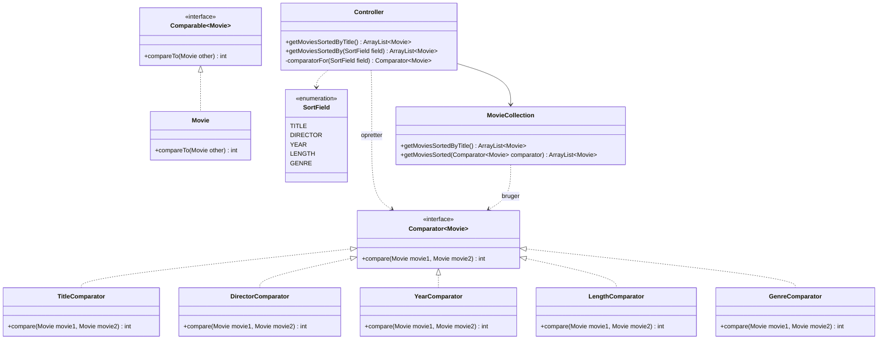

# Filmsamling

Et konsolprogram i Java, hvor man kan holde styr på sin filmsamling:
oprette, vise, søge, redigere, slette og sortere film, og markere dem som set.
Filmene gemmes i `movies.csv`.
## Gruppen

| Fornavn   | GitHub-brugernavn                            |
|-----------|----------------------------------------------|
| Visar     | [Visar122](https://github.com/Visar122)      |
| Sebastian | [Sebber05](https://github.com/Sebber05)      |
| Nikolai   | [NikolaiJelinek](https://github.com/NikolaiJelinek)      |
| Zana | [Zana2630](https://github.com/Zan2630)      |
## Kør programmet

Åbn projektet i IntelliJ og kør `Main.main()`.

## Struktur

Klasserne er delt i tre packages:

- `ui` – `UserInterface` (al input og output)
- `domainmodel` – `Controller`, `MovieCollection`, `Movie`, `Genre`, `SortField` og comparatorerne
- `datasource` – `FileHandler` (læser og skriver `movies.csv`)

Se også:
- [Klassediagram](docs/klassediagram.md)
- [FURPS](docs/furps.md)

## Del 9 – Sortering

Diagrammet viser kun det, der er nyt i del 9.

US18 (sortering efter to egenskaber) er en ekstraopgave og er ikke lavet.
